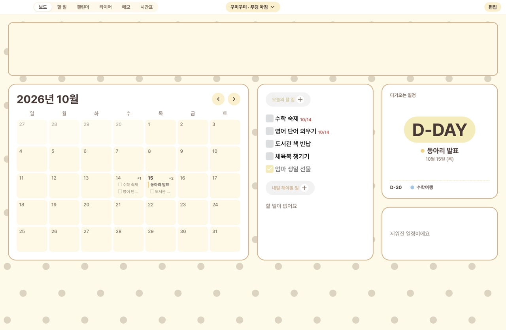
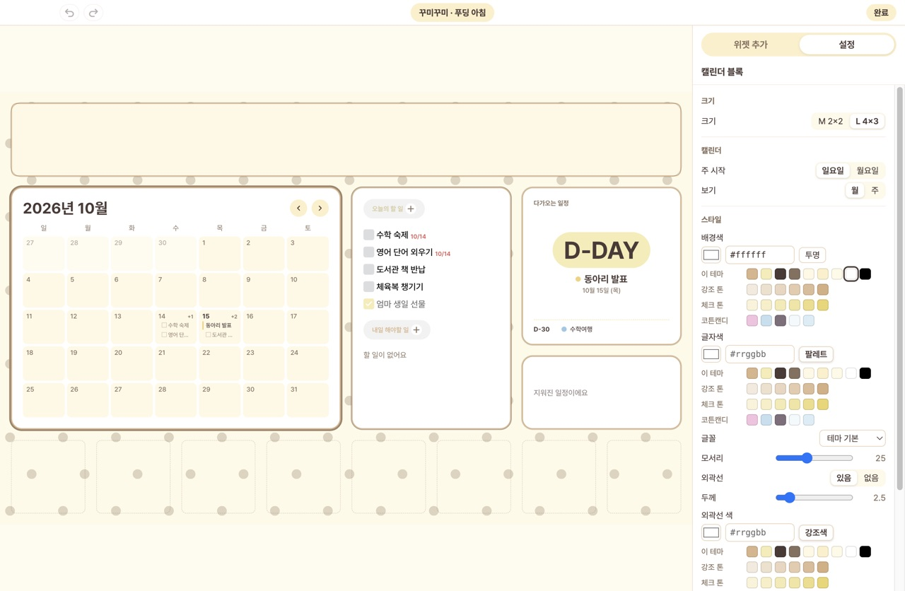
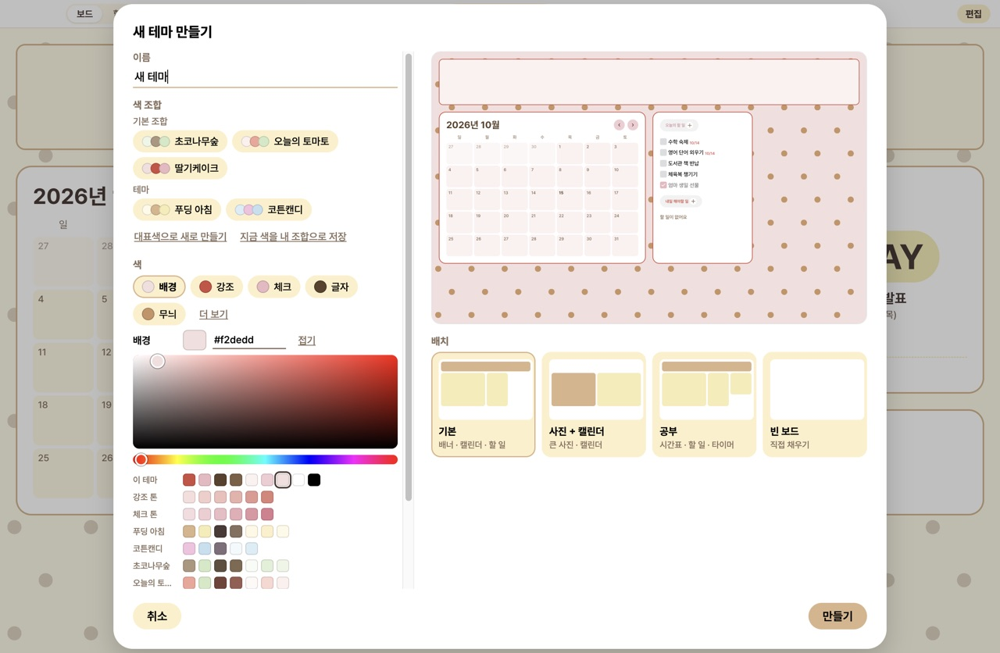
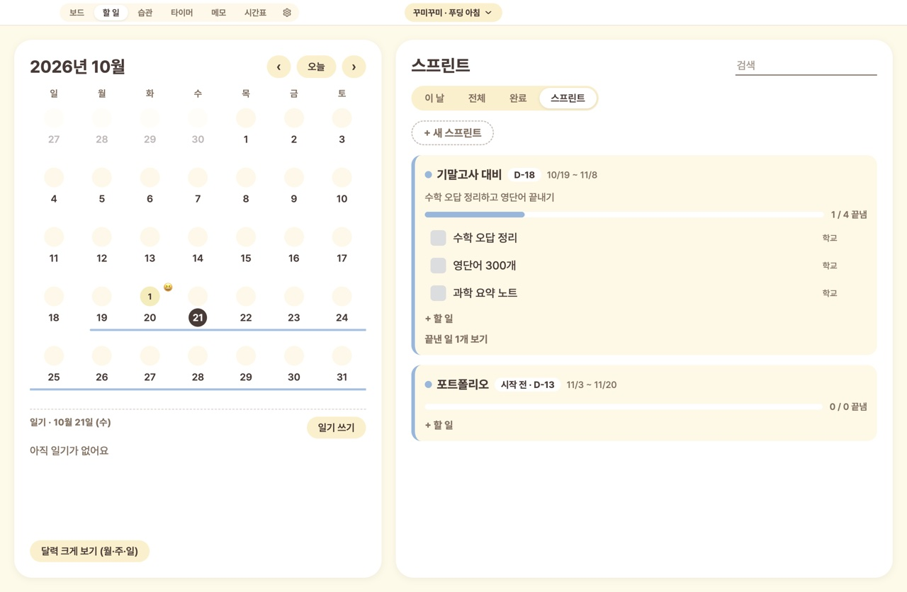
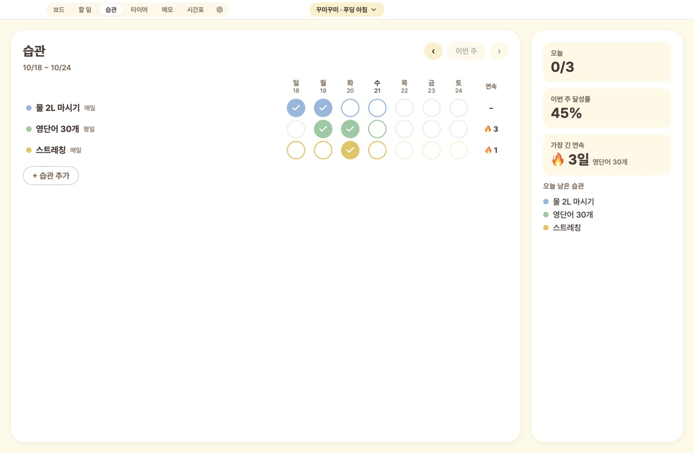
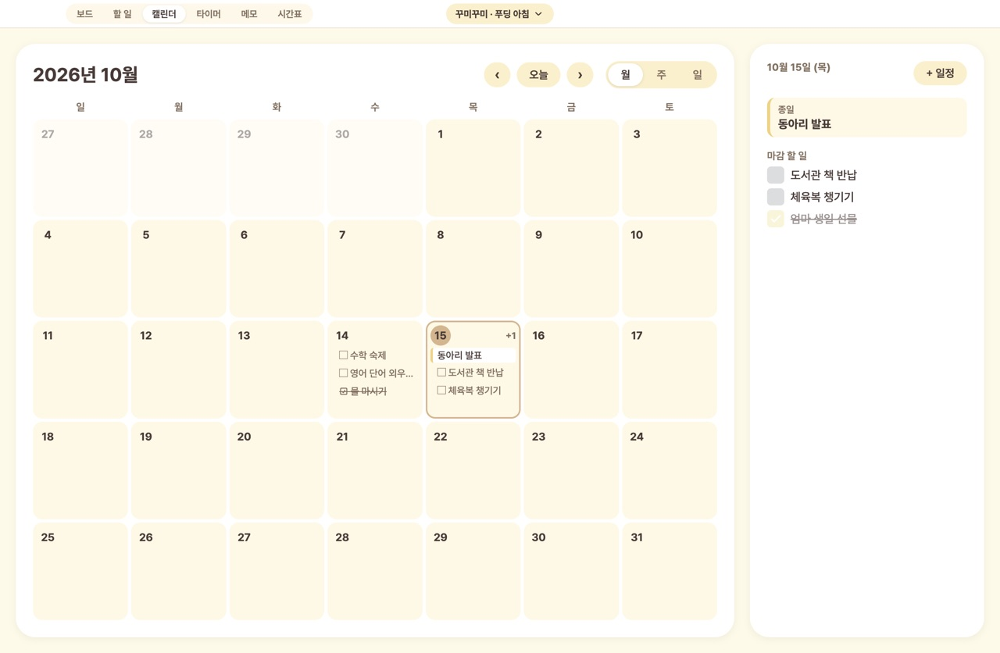
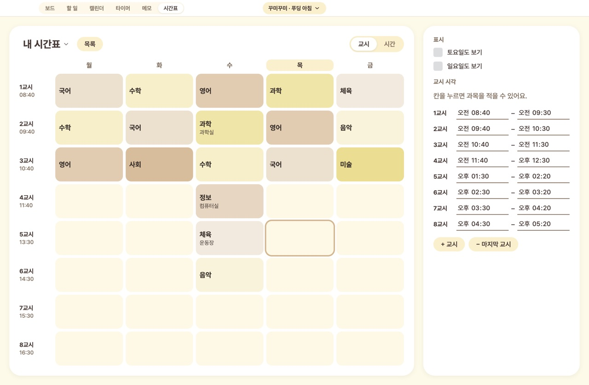
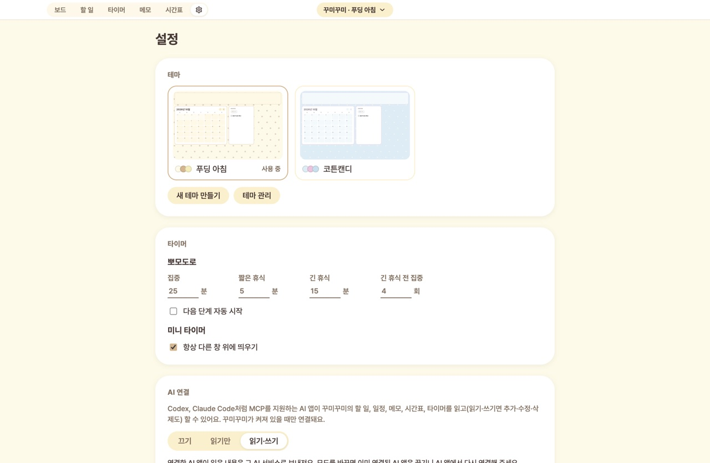

<p align="center">
  
</p>

<h1 align="center">꾸미꾸미</h1>

<p align="center">
  할 일, 캘린더, 습관, 타이머, 시간표를 한 화면에 모아 내 마음대로 꾸미는 데스크탑 보드 앱
</p>

<p align="center">
  <a href="https://github.com/harinsd404/kkumikkumi/releases/download/v0.3.0/kkumikkumi-0.3.0-arm64.dmg"><b>⬇ 다운로드 (macOS, Apple Silicon, 0.3.0)</b></a>
  <br />
  <a href="https://github.com/harinsd404/kkumikkumi/releases/latest">최신 릴리스</a> · <a href="CHANGELOG.md">업데이트 내역</a>
</p>

<p align="center">
  
</p>

## 소개

꾸미꾸미는 창 하나에 위젯 블록을 퍼즐처럼 배치해 나만의 "보드"를 만드는 앱입니다.
캘린더, 할 일, 습관, 디데이, 시계, 사진, 스티커를 원하는 자리에 놓고 색과 글꼴과 무늬를 골라 테마로 저장합니다.

- **로컬 우선:** 기본은 내 기기에 저장합니다. 선택적으로 개인 서버에 할 일·카테고리·스프린트·메모를 동기화할 수 있습니다. [서버 설치와 연결](docs/self-hosting.md)
- **Windows 지원:** x64 설치 파일 빌드와 CI를 제공합니다. 기존 0.3.0 다운로드는 macOS용이며, Windows 설치 파일은 새 브랜치의 CI artifact에서 받을 수 있습니다. [Windows 안내](docs/windows.md)
- **꾸미기 중심:** 8×5 격자에 블록을 놓고, 그 위에 사진과 스티커를 자유롭게 붙입니다.
- **테마:** 기본 테마 두 개(푸딩 아침, 코튼캔디)와 직접 만든 테마를 바꿔 가며 씁니다.
- **AI 연결:** Codex, Claude Code 같은 AI 앱에서 할 일과 일정을 말로 넣고 볼 수 있습니다(MCP, 기본은 꺼짐).

## 주요 기능

| 기능                | 설명                                                                                                                                               |
| ------------------- | -------------------------------------------------------------------------------------------------------------------------------------------------- |
| **보드 편집**       | 위젯 갤러리에서 끌어다 놓기, 크기 바꾸기(S/M/L), 격자 스냅, 실행 취소/다시 실행, 자동 저장                                                         |
| **사진·스티커**     | 자유 배치(이동·회전·크기·앞뒤 순서), 사진 끌어서 보이는 부분 조정, 스티커의 흰 배경 지우기, 위젯 뒤 배경 사진                                      |
| **할 일**           | 카테고리별 할 일, 마감일, 작은 달력(날짜별 남은 할 일 수)과 고른 날 보기, 검색, 끌어서 다른 카테고리·스프린트로 옮기기, 보드의 "오늘의 할 일" 위젯 |
| **스프린트**        | "중간고사 대비 10/20~11/2"처럼 기간·목표를 정하고 그동안 끝낼 할 일 모으기, 진행률·D-N, 달력의 기간 줄, 스프린트 위젯                              |
| **습관**            | 이번 주 표에 체크, 하는 요일 정하기, 연속 기록·달성률, 보드에서 바로 체크하는 습관 위젯                                                            |
| **일기**            | 날짜마다 기분 5단계·글·사진 4장, 달력 칸에 기분 이모지                                                                                             |
| **캘린더**          | 월/주/일 보기, 종일·시각 일정, 끌어서 날짜·시각 옮기기, 마감 있는 할 일 함께 보기                                                                  |
| **디데이**          | 캘린더 일정으로 D-N / D-DAY / D+N 표시(가장 가까운 일정 자동 또는 특정 일정 고정)                                                                  |
| **작은 위젯**       | 공부 통계(집중 시간·연속 공부한 날), 진행률(오늘/주/달/해/직접 지정 기간), 시계(디지털·아날로그)                                                   |
| **타이머·뽀모도로** | 집중/휴식, 뽀모도로 사이클, 기록과 통계, 항상 위에 띄우는 미니 타이머 창                                                                           |
| **메모**            | 간단한 서식(제목, 목록, 체크리스트, 굵게, 취소선), 블록에서 바로 체크                                                                              |
| **시간표**          | 교시 방식과 시간 방식, 시간표 여러 개, 테마 색을 따라가는 칸 색                                                                                    |
| **테마 만들기**     | 색·무늬·글꼴·배치 템플릿 선택, 실시간 미리보기, 자유 색 고르기, 대표색으로 팔레트 자동 생성, 내 색 조합 저장                                       |
| **설정**            | 테마 미리보기로 고르기, 뽀모도로·미니 타이머, AI 연결, 앱 정보(톱니 탭 또는 ⌘,)                                                                    |
| **AI 연결(MCP)**    | AI 앱이 할 일·스프린트·습관·일정·메모·시간표·타이머를 읽고 바꾸기(끄기 / 읽기만 / 읽기·쓰기, 일기는 열지 않음)                                     |

<table>
  <tr>
    <td></td>
    <td></td>
  </tr>
  <tr>
    <td align="center">편집 모드: 보드를 가리지 않는 위젯·설정 패널</td>
    <td align="center">새 테마 만들기: 색 조합, 자유 색 고르기, 미리보기</td>
  </tr>
  <tr>
    <td></td>
    <td></td>
  </tr>
  <tr>
    <td align="center">할 일 + 작은 달력 + 일기, 스프린트</td>
    <td align="center">습관: 이번 주 체크와 연속 기록</td>
  </tr>
  <tr>
    <td></td>
    <td></td>
  </tr>
  <tr>
    <td align="center">캘린더</td>
    <td align="center">시간표</td>
  </tr>
  <tr>
    <td colspan="2"></td>
  </tr>
  <tr>
    <td colspan="2" align="center">설정: 테마 미리보기, 타이머, AI 연결</td>
  </tr>
</table>

## AI 연결 (MCP)

꾸미꾸미가 켜져 있으면 MCP를 지원하는 AI 앱이 꾸미꾸미의 데이터를 다룰 수 있습니다. 예: "내일 오후 3시에 치과 일정 넣어줘", "이번 주 마감인 할 일 보여줘", "중간고사 대비 스프린트에 수학 오답 정리 넣어줘", "오늘 물 마시기 습관 체크해줘", "25분 집중 타이머 시작해줘". "월요일 1교시 국어, 2교시 수학으로 시간표 만들어줘"처럼 시간표도 만들거나 통째로 바꿀 수 있습니다([입력 예시](docs/mcp.md#시간표-저장)).

1. 설정 → **AI 연결**에서 "읽기만" 또는 "읽기·쓰기"를 고릅니다.
2. 그 아래에 나오는 설정을 복사해 AI 앱에 넣습니다. 예(Codex):
   ```sh
   codex mcp add kkumikkumi -- /usr/bin/nc -U "$HOME/Library/Application Support/kkumikkumi/mcp/kkumikkumi.sock"
   ```
3. AI 앱을 다시 시작하거나 다시 연결합니다.

- 데이터는 여전히 이 Mac 안에만 저장되지만, **AI 앱이 읽은 내용은 그 AI 서비스로 보내집니다.**
- 일기는 개인적인 내용이라 AI 연결에 열지 않습니다.
- 지우기는 되돌릴 수 없으니 AI 앱의 실행 전 확인을 켜 두는 것을 권장합니다. 테마, 사진, 앱 설정은 AI가 바꿀 수 없습니다.
- 구조와 도구 목록, 보안 대응은 [docs/mcp.md](docs/mcp.md)를 참고하세요.

## 설치

Apple Silicon Mac(M1 이상)용 DMG를 제공합니다. 아직 Apple 공증을 받지 않아 처음 열 때 한 번 허용이 필요합니다.

1. [릴리스 페이지](https://github.com/harinsd404/kkumikkumi/releases/latest)에서 `kkumikkumi-0.3.0-arm64.dmg`를 받아 열고 **꾸미꾸미**를 Applications로 끌어 놓습니다.
2. 처음 열 때 경고가 뜨면 **시스템 설정 → 개인정보 보호 및 보안 → 확인 없이 열기**를 누릅니다.

이전 버전 위에 덮어쓰면 데이터는 그대로 남습니다. 버전별 변경은 [CHANGELOG.md](CHANGELOG.md)에 있습니다.
자세한 설치·삭제 방법과 배포 절차는 [docs/release.md](docs/release.md)를 참고하세요.

## 개발

### 요구 사항

- macOS 또는 Windows x64 (각 운영체제에서 패키징)
- Node.js 24 이상 (동기화 서버 포함)
- pnpm 11

### 명령

```sh
pnpm install
pnpm dev             # 개발 실행(main/IPC 코드를 바꾸면 다시 켜야 반영)
pnpm typecheck       # 타입 검사
pnpm lint            # ESLint + Prettier
pnpm test            # 단위 테스트(Vitest)
pnpm test:electron   # main 프로세스 테스트(SQLite·sharp, Electron의 Node로 실행)
pnpm build           # 빌드
pnpm dist            # macOS DMG 만들기(apps/desktop/dist)
pnpm --filter @kkumikkumi/desktop dist:win  # Windows에서 x64 설치 파일 만들기
```

### 기술 스택

| 영역    | 사용                                                                      |
| ------- | ------------------------------------------------------------------------- |
| 앱      | Electron 44, React 19, TypeScript(strict), electron-vite                  |
| 데이터  | `node:sqlite`(사용자 데이터), 테마는 폴더(`theme.json` + 에셋)            |
| 검증    | zod 4 (스키마는 `packages/schema` 한 곳에서 정의)                         |
| AI 연결 | `@modelcontextprotocol/sdk` (macOS Unix 소켓 / Windows 인증된 Named Pipe) |
| 이미지  | sharp (디코딩 → 축소 → PNG/JPEG 재인코딩 → 해시)                          |
| 테스트  | Vitest                                                                    |
| 패키징  | electron-builder (DMG / Windows NSIS, Electron 퓨즈)                      |
| 동기화  | 선택적 개인 서버(Node 24 HTTP + SQLite), Docker Compose                   |

의존성마다 추가한 이유와 대안은 [docs/dependencies.md](docs/dependencies.md)에 적어 둡니다.

### 구조

```
apps/desktop/
  src/main/        파일·DB·창·OS 연동, IPC 핸들러(입력은 zod로 재검증), mcp/(AI 연결)
  src/preload/     renderer에 최소 API만 노출
  src/shared/      IPC 채널·타입, 앱 이름 상수
  src/renderer/
    board/         보드 렌더러(순수 React, electron을 import하지 않음)와 블록
    editor/        편집 상태(reducer·실행 취소·자동 저장), 인스펙터, 위젯 갤러리
    pages/         할 일·캘린더·스프린트·일기·습관·타이머·메모·시간표·설정 세부 화면
    app/           화면 조립, 테마 창, 대화창, 데이터 훅
  electron-builder.yml, build/, scripts/   패키징 설정과 아이콘
packages/schema/   테마·사용자 데이터 스키마, 기본값, 격자 판정 함수
docs/              확인된 사실, 의존성, 폰트 라이선스, 배포 문서
```

시간·격자·색 계산 같은 로직은 순수 함수로 분리하고 단위 테스트를 둡니다.

## 보안과 개인정보

- `contextIsolation`, `sandbox`, `nodeIntegration: false`, 엄격한 CSP를 사용하고, 외부 페이지 이동과 새 창은 막습니다.
- main 프로세스는 renderer에서 오는 모든 입력을 zod로 다시 검증합니다. 우리 앱 페이지(메인 프레임)에서 온 호출만 처리합니다.
- 배포본은 Node 실행 모드, `NODE_OPTIONS`, 디버거 인자를 끈 Electron 퓨즈를 쓰고, 원격 디버깅 포트로 실행하면 종료합니다.
- AI 연결(MCP)은 기본으로 꺼져 있습니다. macOS는 사용자 전용 Unix 소켓, Windows는 사용자별 비밀값으로 인증하는 Named Pipe를 사용합니다. AI가 부르는 도구도 같은 zod 검증을 거치며 테마·에셋·설정은 열지 않습니다.
- 개인 서버 동기화는 명시적으로 연결한 뒤에만 데이터를 전송합니다. 접속키는 OS 저장소로 암호화하고, 원격 연결은 HTTPS(SSH 터널은 루프백 HTTP)만 허용합니다. 서버 운영자는 저장된 데이터에 접근할 수 있으며 종단간 암호화는 제공하지 않습니다.
- 오류 기록에는 오류 종류만 남기고 할 일, 일정, 파일 경로 같은 사용자 데이터는 남기지 않습니다.
- 일기 사진도 다른 사진처럼 다시 인코딩해 앱 데이터 폴더(`diary/`)에만 두고, 앱이 저장한 사진만 불러옵니다.
- 데이터 위치: macOS `~/Library/Application Support/kkumikkumi`, Windows `%APPDATA%/kkumikkumi`. 오류 기록은 설정에서 폴더를 열 수 있습니다.

## 로드맵

- [x] 보드·편집기, 할 일·캘린더·타이머·메모·시간표·디데이 블록
- [x] 테마 만들기·관리, 색 조합, 1차 배포(펫 제외)
- [x] 할 일+캘린더 한 화면과 카테고리, AI 연결(MCP), 설정 페이지 (0.2.0)
- [x] AI로 시간표 만들기·바꾸기, 사진 삭제 후 저장 오류 수정 (0.2.1)
- [x] 스프린트, 일기, 습관, 공부 통계·진행률·시계 위젯, 위젯 배경 사진, 할 일 끌어서 옮기기 (0.3.0)
- [ ] 데스크탑 펫(바탕화면 위를 돌아다니는 캐릭터, 타이핑·음악에 반응)
- [ ] 시간·요일·집중 모드·다크 모드에 따른 테마 자동 전환
- [ ] 테마 파일 내보내기/가져오기(zip)
- [ ] 개발자 ID 서명·공증, Intel Mac 지원

## 기여

기여해 주신 분들께 감사드립니다.

- [@somonox](https://github.com/somonox): 사진 삭제 후 저장 오류 수정, AI 시간표 쓰기 도구 `set_timetable` ([PR #1](https://github.com/harinsd404/kkumikkumi/pull/1))

버그 제보나 제안은 [Issues](https://github.com/harinsd404/kkumikkumi/issues)에, 코드 기여는 Pull Request로 보내 주세요. 보내기 전에 `pnpm typecheck && pnpm lint && pnpm test && pnpm test:electron`을 통과하는지 확인해 주세요.

## 폰트

앱에 들어 있는 글꼴은 [Pretendard](https://github.com/orioncactus/pretendard)와 [갈무리11](https://github.com/quiple/galmuri)이며 둘 다 SIL Open Font License 1.1을 따릅니다.
라이선스 원문은 빌드 결과물에 함께 들어가고, 검토 내용은 [docs/fonts.md](docs/fonts.md)에 있습니다.
